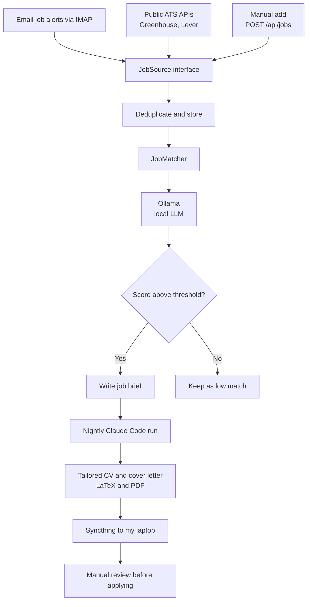

# JobScout

A self-hosted agent that collects junior Java backend job ads, scores them against my profile with a local LLM, and prepares tailored application drafts for me to review.

> **Status:** early development. The infrastructure is running, and the job matcher is the first component being built. See the [roadmap](#roadmap).

## Why

Job ads are spread across several sites, and many of them don't fit. JobScout gathers them in one place, scores each ad, and turns the strongest matches into a tailored CV and cover letter.

It runs on a home server, on CPU only, with no paid API. Nothing is ever sent to an employer automatically: JobScout finds, scores and prepares, and I review everything before applying.

## How it works



1. **Collect.** Each source implements a common `JobSource` interface, so new sources can be added without changing the rest of the pipeline.
2. **Score.** `JobMatcher` sends the ad and my profile to the model and gets back a score and a reason. The response is constrained by a JSON schema through Ollama's `format` parameter.
3. **Brief.** Each job scoring above the threshold gets a brief with the ad text, link, score and reason.
4. **Tailor.** A nightly job runs Claude Code in headless mode (`claude -p`) on each brief, using my master LaTeX CV and cover letter.
5. **Deliver.** Generated files sync to my laptop through Syncthing, for review.

## Design decisions

- **Respectful sourcing:** no scraping and no automated logins to job sites. Ads come from email alerts I subscribed to, public ATS APIs and links I add myself.
- **Replaceable model:** the `JobMatcher` interface hides the provider. Ollama is the current implementation, and a hosted model could be added later.
- **Structured output:** a JSON schema gives the application a predictable result to parse, instead of free text.
- **Truthful applications:** CV tailoring only reorders and emphasises existing content. It must not invent experience or skills.
- **Limited agent permissions:** the headless agent can read the brief and master files, edit only its output folder, and run only the LaTeX build. Everything else is denied.
- **Human review:** every generated document is checked by hand before it is used.

## Tech stack

| Area | Technology |
| --- | --- |
| Backend | Java 21, Spring Boot 4, Maven |
| LLM integration | Spring `RestClient`, calling Ollama directly |
| Local model | `qwen3:4b-instruct`, running on CPU |
| Document generation | Claude Code, LaTeX, Tectonic |
| Infrastructure | Debian 13, Docker, systemd timers |
| Delivery and remote access | Syncthing, Tailscale |

## Performance

The current model runs at about 3.9 tokens per second on the home server, or roughly 30 seconds per job ad. That is too slow for interactive use but fine for a background job, so scoring is designed to run asynchronously.

## Running Ollama

The application itself isn't runnable yet. The model server it will use can be started like this:

```bash
docker run -d \
  --name ollama \
  --restart unless-stopped \
  --memory=5g \
  -p 127.0.0.1:11434:11434 \
  -v /data/ollama:/root/.ollama \
  ollama/ollama

docker exec ollama ollama pull qwen3:4b-instruct
```

The port is bound to `127.0.0.1`, so Ollama isn't exposed to the network. From another machine, use an SSH tunnel:

```bash
ssh -L 11434:localhost:11434 <homelab-host>
```

## Roadmap

- [ ] **0. Alerts:** dedicated mailbox and job alerts, to collect real data
- [ ] **1. Matcher:** `JobMatchResult`, `JobMatcher`, `OllamaJobMatcher`, `POST /api/match`
- [ ] **2. Profile:** add my CV profile to the prompt
- [ ] **3. Persistence:** storage and deduplication
- [ ] **4. Sources:** IMAP alerts, public ATS APIs, manual add
- [ ] **5. Applications:** briefs, headless CV tailoring, Syncthing delivery
- [ ] **6. Deployment:** run the full application in Docker on the home server

## Security and privacy

- Credentials stay in environment variables and are never committed.
- Personal documents, job data and generated applications stay outside this repository.
